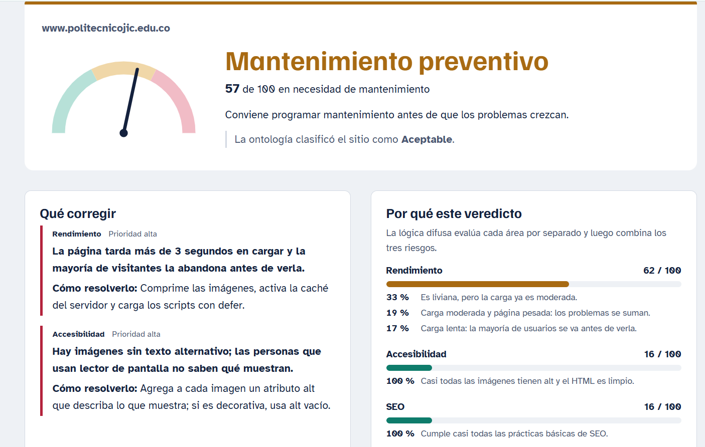
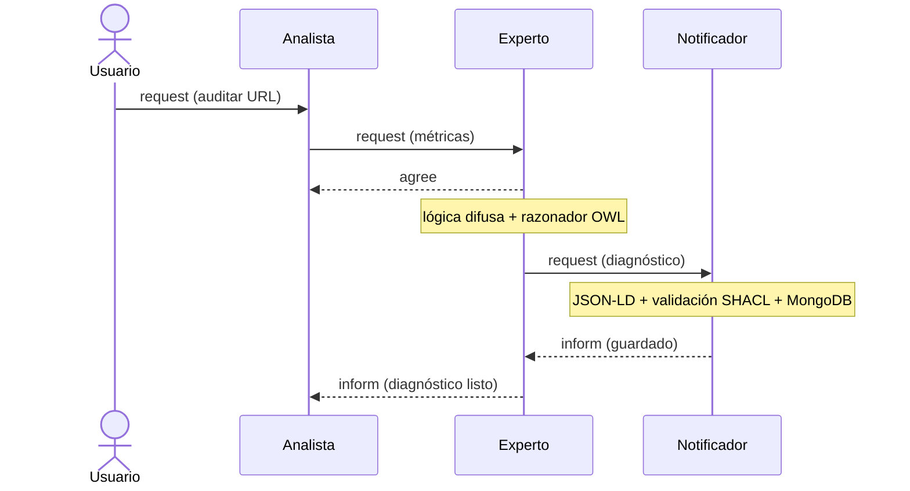
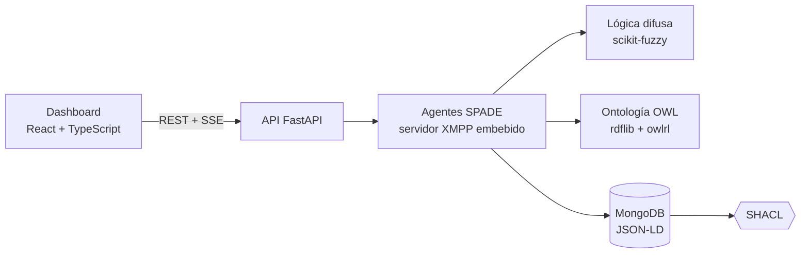

# OntoAudit

[](https://github.com/nicholasph05/OntoAudit/actions/workflows/ci.yml)

Auditoría inteligente de sitios web. Tres agentes SPADE miden una página, la evalúan con
un sistema de **lógica difusa jerárquico**, la clasifican con una **ontología OWL** y
guardan el informe como **datos enlazados (JSON-LD)** en MongoDB. Un dashboard en React
muestra la conversación de los agentes en vivo y explica cada veredicto en lenguaje sencillo.



## Qué hace

1. Escribes la dirección de un sitio.
2. El **Agente Analista** descarga la página (respetando `robots.txt`) y mide seis métricas:
   tiempo de carga, peso, imágenes sin texto alternativo, errores de HTML, título y descripción.
3. El **Agente Experto** combina dos razonamientos:
   - **Lógica difusa**: tres subsistemas (Rendimiento, Accesibilidad, SEO) alimentan un
     veredicto global: *Al día*, *Preventivo* o *Urgente*, con las reglas que se activaron.
   - **Ontología OWL**: detecta los problemas por umbral, y el razonador infiere el estado
     del sitio y las recomendaciones que necesita.
4. El **Agente Notificador** convierte el diagnóstico en JSON-LD (schema.org + W3C EARL),
   lo valida con **SHACL** y lo guarda en MongoDB.

Los agentes se comunican con mensajes **FIPA-ACL** siguiendo el protocolo **FIPA-Request**:



## Arquitectura



| Carpeta | Contenido |
|---|---|
| `ontologia/` | Ontología `mantenimiento_web.owl` (Protégé) y consultas SPARQL con razonamiento OWL 2 RL |
| `fuzzy/` | Sistema difuso jerárquico de 20 reglas y gráficas de las funciones de pertenencia |
| `agentes/` | Analizador web y los tres agentes SPADE con su bitácora ACL |
| `persistencia/` | Conversión a JSON-LD, formas SHACL y repositorio MongoDB |
| `api/` | API REST con FastAPI, eventos en vivo (SSE) y protección contra SSRF |
| `frontend/` | Dashboard en React + TypeScript (Vite) |
| `tests/` | 38 pruebas automáticas (pytest) |

## Decisiones técnicas

- **Ontología que razona, no solo almacena.** Las clases definidas (`SitioCritico`,
  `ProblemaSEO`…), la propiedad inversa `atiendeProblema` y la cadena
  `presentaProblema ∘ sugiereAccion → necesitaRecomendacion` hacen que el razonador deduzca
  el estado del sitio y sus recomendaciones. Los umbrales viven en la ontología, no en el código.
- **Lógica difusa jerárquica.** Con seis entradas en un único sistema harían falta cientos de
  reglas; tres subsistemas y un nivel global lo resuelven con 20, y además dicen en qué área
  está el problema.
- **Vocabularios estándar.** Los informes usan schema.org y [EARL](https://www.w3.org/TR/EARL10-Schema/),
  el vocabulario del W3C para resultados de evaluación. La API ofrece cada informe en JSON-LD
  o en Turtle según el encabezado `Accept`.
- **Validación antes de guardar.** Un informe que no cumple las formas SHACL no llega a la
  base de datos; el agente responde `failure` con el motivo.
- **Accesible por diseño.** El dashboard usa Atkinson Hyperlegible, funciona con teclado,
  anuncia los mensajes nuevos a lectores de pantalla y respeta `prefers-reduced-motion`.

## Cómo ejecutarlo

### Con Docker (recomendado)

```bash
docker compose up --build
```

Abre <http://localhost:8000>. MongoDB y la aplicación se levantan juntos.

### En local

Requisitos: Python 3.12, Node.js 20+ y MongoDB (opcional: sin él, los informes se guardan en memoria).

```bash
python -m venv .venv
.venv\Scripts\activate            # Windows  (Linux/macOS: source .venv/bin/activate)
pip install -r requirements.txt
uvicorn api.main:app --reload     # API y agentes en http://127.0.0.1:8000

cd frontend
npm install
npm run dev                       # dashboard en http://localhost:5173
```

También puedes auditar desde la consola:

```bash
python -m agentes.plataforma https://example.com
```

## API

Documentación interactiva en `/docs` (generada por FastAPI).

| Método | Ruta | Descripción |
|---|---|---|
| `POST` | `/api/auditorias` | Inicia una auditoría y devuelve su id |
| `GET` | `/api/auditorias/{id}/eventos` | Conversación ACL en vivo (Server-Sent Events) |
| `GET` | `/api/auditorias/{id}` | Informe JSON-LD (`Accept: text/turtle` para Turtle) |
| `GET` | `/api/auditorias` | Auditorías recientes |
| `GET` | `/api/sitios/historial?url=` | Evolución de un sitio |
| `GET` | `/api/ontologia/problemas` | Problemas, umbrales y soluciones de la ontología |
| `GET` | `/api/salud` | Estado de los agentes y del almacenamiento |

## Pruebas

```bash
python -m pytest -v
```

Cubren la inferencia de la ontología, la monotonía y robustez del sistema difuso, el
analizador (con un sitio web local falso), el protocolo ACL completo entre agentes, la
validación SHACL, el repositorio y la API de punta a punta. GitHub Actions las ejecuta en
cada push, junto con la compilación del dashboard y de la imagen Docker.

## Limitaciones conocidas

- El tiempo de carga se mide desde el servidor que ejecuta la auditoría y descarga hasta
  40 recursos por página; es una aproximación, no una medición de navegador real.
- El servidor XMPP embebido de SPADE solo puede iniciarse una vez por proceso.
- La ontología conoce seis problemas; ampliarla en Protégé amplía el sistema sin tocar el código
  del Experto, pero cada métrica nueva necesita su medición en el Analista.

## Contexto

Proyecto final del curso de Web Semántica. Integra ontologías (OWL/Protégé), lógica
difusa (scikit-fuzzy), sistemas multiagente (SPADE) y datos enlazados (JSON-LD + MongoDB).

Autor: [@nicholasph05](https://github.com/nicholasph05) · Licencia [MIT](LICENSE)
